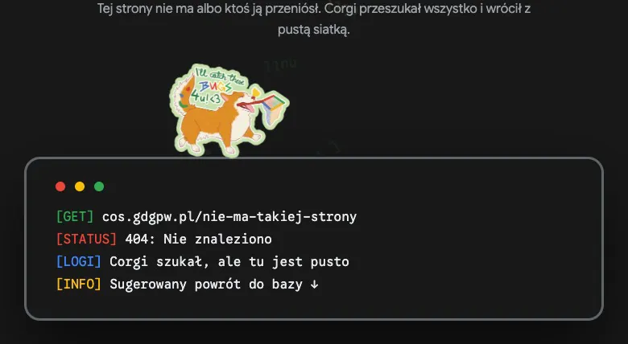
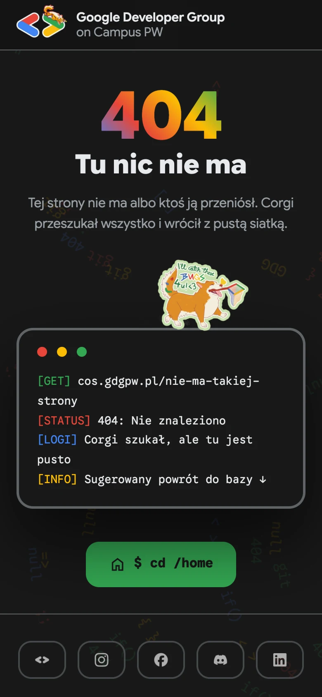

  

  <h1>404 · GDG on Campus PW</h1>
  
Zabłądziłeś na gdgpw.pl? Corgi z siatką na bugi już szuka.

  

    

  
  
  
  
  

---

  
   Corgi patroluje terminal, a terminal pokazuje adres, którego szukałeś.

 

Każda nieistniejąca subdomena `gdgpw.pl` i każda zła ścieżka trafia tutaj zamiast na gołe „404 Not Found”. Jeden przycisk i wracasz do bazy.

---

## 🐕 Easter eggi

  

| Co robisz | Co się dzieje |
|-----------|---------------|
| Klikasz corgiego | Skacze i iskrzy szczęściem |
| 🔴 Czerwona kropka | Terminal „crashuje”, bo corgi odgryzł kabel |
| 🟡 Żółta kropka | Terminal się zwija |
| 🟢 Zielona kropka | Więcej logów z poszukiwań |
| `↑ ↑ ↓ ↓ ← → ← → B A` | Impreza: kolory, szybsze tło, corgi biega |

---

## 📱 Na telefonie

  

---

## Pod maską

- Czysty HTML, CSS i JS. Bez buildów i zależności.
- `nginx.conf` odpowiada tą stroną na każdą nieznaną ścieżkę, ze statusem 404. Sam adres `/` zwraca 200.
- Ścieżki do plików zaczynają się od `/`, więc strona wygląda tak samo pod `/a/b/c`.
- Przy `prefers-reduced-motion` corgi stoi, a tło się nie rusza.
- Lokalnie: `docker compose up --build` i http://localhost:8091/cokolwiek. Prosty serwer Pythona nie przekieruje nieznanych ścieżek.

---

  <a href="https://gdg.community.dev/gdg-on-campus-politechnika-warszawska-warsaw-poland/">GDG on Campus PW</a> &nbsp;·&nbsp; <a href="https://gdgpw.pl">gdgpw.pl</a>

